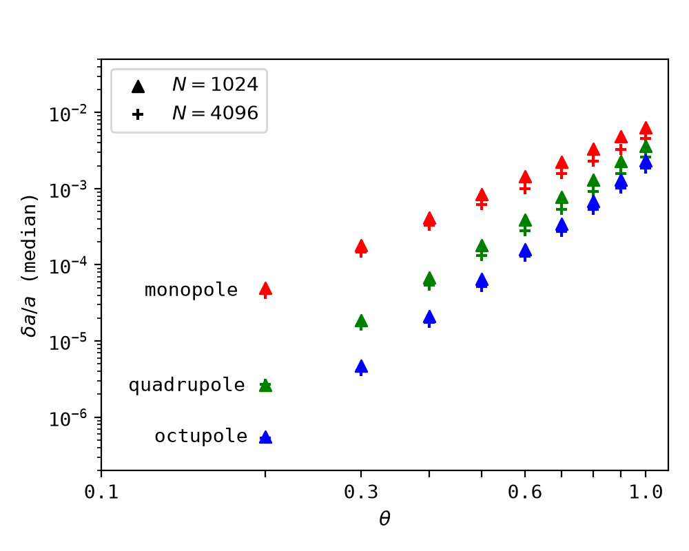
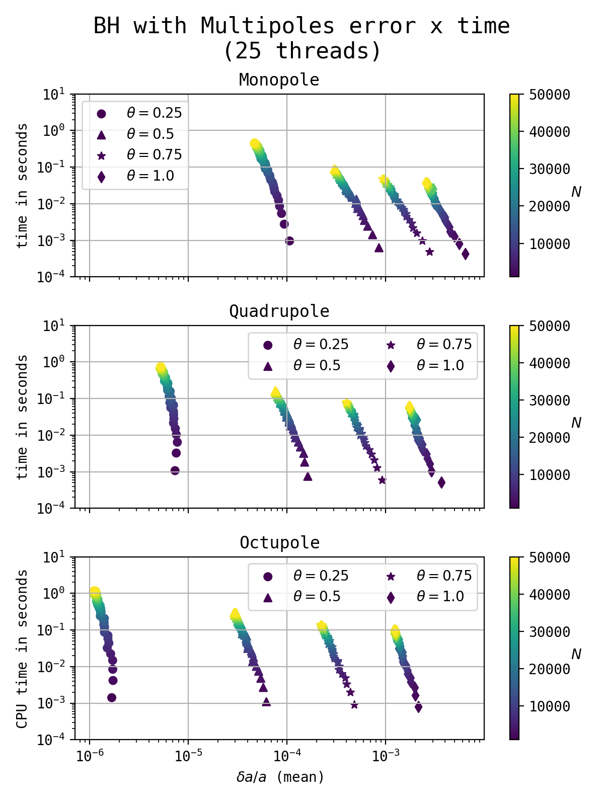
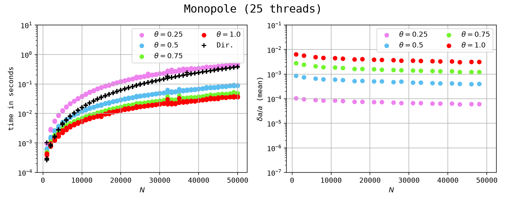
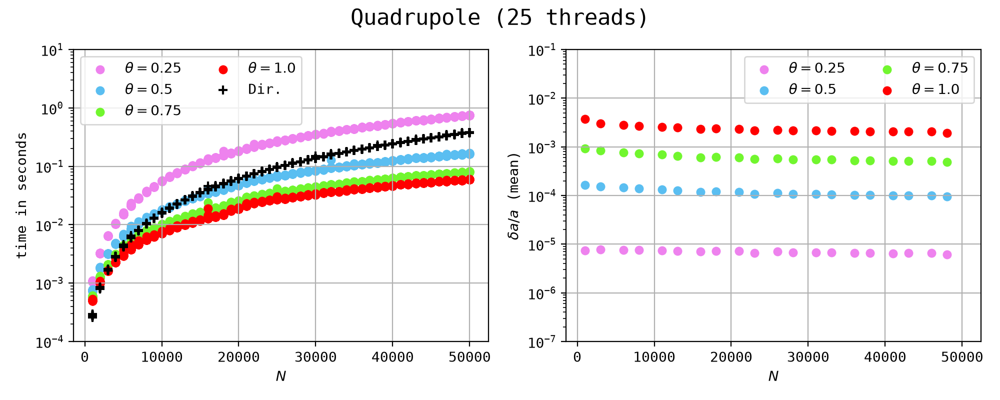
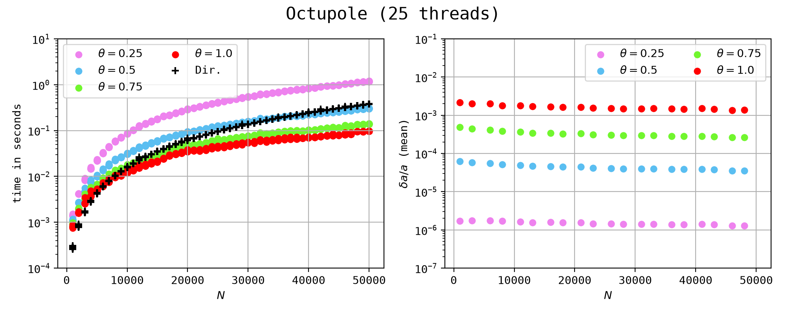

# Benchmark: Forces time and error

Here I'll do some benchmarks of the octree, looking both to the error (compared to the direct forces) and the time to compute the forces. I'll also consider the three implementations of multipoles: monopole (1), quadrupole (4) and octupole (8).

I also reproduce here some results of McMillan and Aarseth (1993), where they implement the octupole for collisional stellar systems.

---

## McMillan and Aarseth Results

As expected.

---

## Multipoles

---

## Bigger $N$

---

# References

**[1]** McMillan, S. L. W. and Aarseth, S. J., “An O(N N) Integration Scheme for Collisional Stellar Systems”, <i>The Astrophysical Journal</i>, vol. 414, IOP, p. 200, 1993. doi:10.1086/173068.